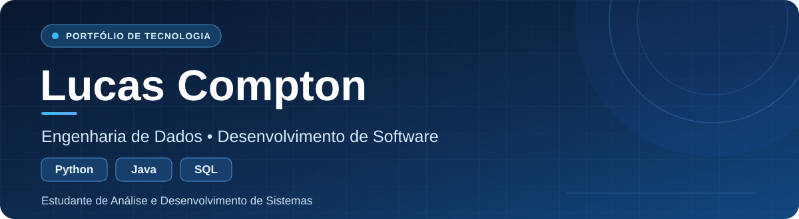

  

## 👋 Sobre mim

Sou estudante de **Análise e Desenvolvimento de Sistemas (ADS) na FAVENI**. Gosto de aprender na prática, desenvolvendo soluções para problemas reais.

- 🐍 **Estudando atualmente:** Python, lógica de programação, algoritmos e estruturas de dados.
- 📊 **Área de maior interesse:** Engenharia de Dados, sem deixar de explorar Desenvolvimento de Software.
- 💻 **Tecnologias utilizadas em projetos publicados:** JavaScript, Node.js, Express.js, SQL e PostgreSQL.
- ☕ **Outros conhecimentos:** Java, que também faz parte da minha trajetória de estudos.
- 🎯 **Objetivo:** conquistar minha **primeira oportunidade em TI**. Estou aberto a estágios em Dados, Desenvolvimento e outras áreas de tecnologia.

## 🛠️ Tecnologias e ferramentas

**Linguagens**

  
  
  
  

**Backend e banco de dados**

  
  
  

**Versionamento**

  
  

> **Foco de aprendizado:** aprofundar Python e desenvolver conhecimentos em SQL, tratamento de dados e pipelines de dados.

## 🚀 Projetos em destaque

### 📦 [Material Log — Controle de Saída de Materiais](https://github.com/LucasCompton00/material-log)

Aplicação web full stack criada a partir de um problema real: substituir registros manuais de saída de materiais por um histórico digital, com registro, consulta e exclusão de movimentações.

**Tecnologias:** HTML, CSS, JavaScript, Node.js, Express.js, SQL e PostgreSQL.

### 🚗 [Calculadora de Custo de Viagem](https://github.com/LucasCompton00/calculadora-custo-viagem)

Aplicação web que estima o consumo de combustível e o custo de uma viagem a partir da distância, do consumo médio do veículo e do preço por litro.

**Tecnologias:** HTML, CSS e JavaScript.

## 📚 Minha trilha de aprendizado

**Agora:** Python e fundamentos de programação  
**Próximos passos:** SQL e bancos de dados → tratamento de dados → ETL e pipelines de dados

## 🤝 Vamos nos conectar?

Estou aberto a **estágios e oportunidades de entrada em TI** e gosto de compartilhar o que aprendo construindo projetos.

🔗 **[LinkedIn — Lucas Compton](https://www.linkedin.com/in/lucas-compton-612720394/)**

<em>Aprender, construir, documentar e melhorar — um projeto de cada vez.</em> 💙

